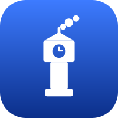
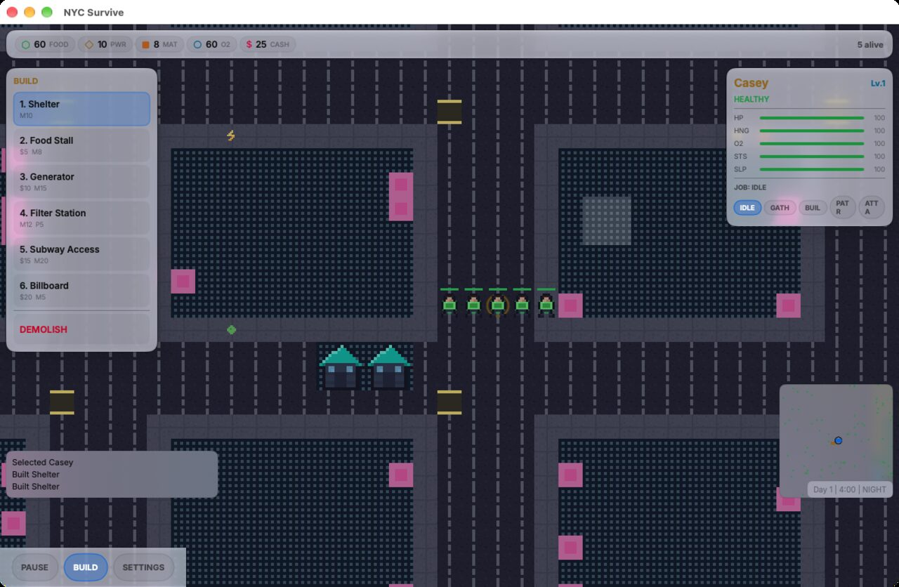
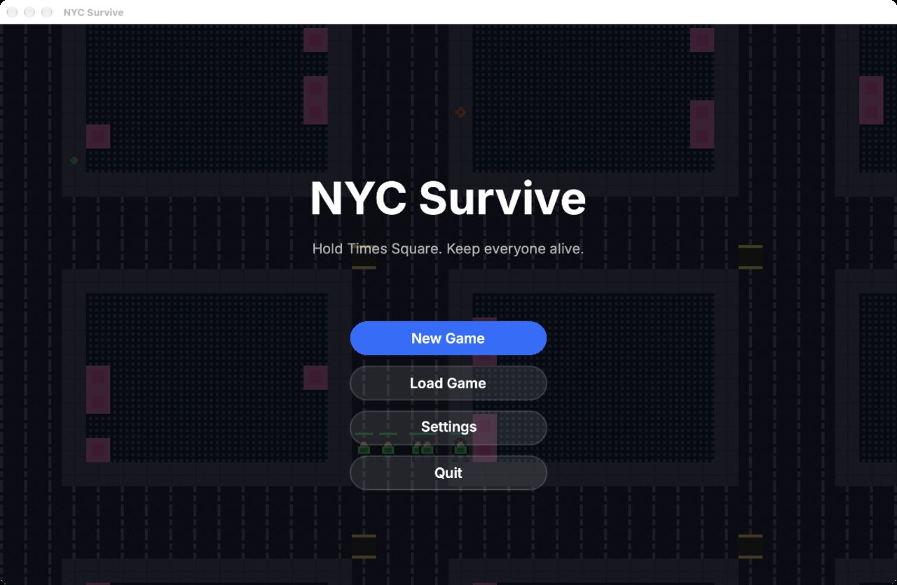

 [](https://github.com/nulljosh/nyc/actions/workflows/test.yml) 

Raise the Beacon.

NYC Survive is a small colony game in the middle of Times Square. You send a crew of survivors to work, build machines that run on their own, and raise the Beacon. Think Pikmin's crew and Factorio's machines, cut down to four buildings and one goal. You decide what everyone does.

**[nyc.jaybulb.com](https://nyc.jaybulb.com)** · **[Play in the browser](https://nyc.jaybulb.com/app/)** · **[App Store](https://apps.apple.com/app/id6782618198)**





## Features

- **Send the crew.** Click a survivor, or drag a box around several. Click a resource and they work it until you say otherwise. Click the ground to move them. Nobody works on their own.
- **Three resources.** Food, materials and power.
- **Four buildings.** Shelters add four beds. Generators make power. A drill beside a resource mines it and burns power, one drill per patch. The Beacon is the win.
- **The crew grows.** A free bed and 10 food bring a new survivor each day, up to 20.
- **Win.** Raise the Beacon: 8,000 materials and 1,000 power. About fifteen minutes if you build well.
- **Saves.** Autosave runs about once a minute. There are three save slots.
- **Apple.** iPhone, iPad and Mac. The Mac app has a resizable window and a full screen switch in Settings.
- **Web.** The same game runs in a browser at [/app](https://nyc.jaybulb.com/app/), with WebMCP tools for browser agents.
- **Apple Watch.** A quick reference for building costs.

## Run

```bash
xcodegen generate && open NYCSurvive.xcodeproj
```

Needs Xcode 16 or later. The app targets iOS 17 and macOS 15.

Other ways in:

- **Web.** `cd web && python3 -m http.server 8000`, then open http://localhost:8000. Modules need a server, so `file://` will not work.
- **Headless playthrough.** `scripts/playthrough.sh 200` plays the bot to the win with no window.
- **Apple Watch.** `cd watchos && xcodegen generate && open NYCSurviveWatch.xcodeproj`

## Tests

```bash
node --test
xcodebuild test -project NYCSurvive.xcodeproj -scheme NYCSurvive -destination 'platform=macOS' -only-testing:SimTests
```

`node --test` runs the web tests, including `web/winnable.test.mjs`, which plays the game to a win. The Swift tests live in `Tests/SimTests.swift`.

## Docs

- [Controls](docs/CONTROLS.md): every key, click and tap.
- [Whitepaper](WHITEPAPER.md): how the game works and why.
- [Architecture](docs/ARCHITECTURE.md) and [Web API](docs/API.md).
- [Changelog](CHANGELOG.md).

Found a security problem? Email trommatic@icloud.com. See [SECURITY.md](SECURITY.md).

## Privacy

NYC Survive collects nothing. Saves stay on your device. There are no accounts, no analytics and no network calls. The full [privacy policy](https://nyc.jaybulb.com/app/privacy) is on the site.

## License

Apache License 2.0. See [LICENSE](LICENSE). Copyright 2026 Joshua Trommel.

The NYC Sans typeface is Inter, renamed. It stays under the SIL Open Font License 1.1, see [Resources/Fonts/OFL.txt](Resources/Fonts/OFL.txt).
