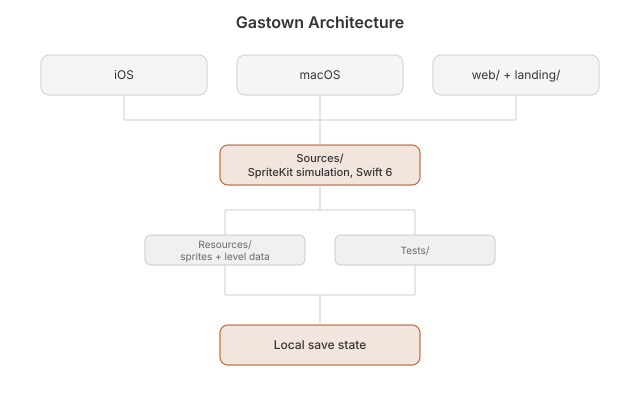

# Architecture

A Vancouver colony game where you command a crew, build machines that run themselves, and raise the Steam Clock on a 128x128 grid. Three resources: food, materials and power. The game runs on SpriteKit (macOS and iOS) and in the browser (`web/`), with a watchOS quick-reference companion.

## How it runs

**macOS**: `Sources/App/GastownApp.swift` is the entry point. A SwiftUI window hosts an `SKView` with `GameScene` for rendering. Keyboard and mouse go through `InputHandler`, which emits commands to `GameState`. Each tick `GameScene` runs the systems in order: `JobSystem` (colonists walk), `ResourceSystem` (gathering and node respawn), `ColonySystem` (machines, recruits, win), `TimeSystem` (clock). The HUD (resource bar, build menu, colonist panel, tutorial) is SwiftUI layered on top.

**iOS**: `Sources/AppiOS/GastownApp.swift` is the entry point. Touch (tap, drag, pinch) goes through the same `InputHandler` into the same `GameScene`.

**Web**: `web/` is a plain ES-module port with the same rules and numbers (`web/js/systems.js` mirrors `ColonySystem`). It is kept in step with the native game, and both bots (`web/sim.mjs`, `scripts/playthrough.sh`) win in about 12 game days.

**Saving**: three slots, saved with Cmd+S or from Settings, and automatically every 60 ticks (about 15 seconds) while a game runs. Native writes JSON `save2_<slot>.json` through `SaveManager`; the web writes `nyc2_save_<slot>` to `localStorage`. 1.x saves are left alone and never loaded.

## The rules, in code

Start: 30 food, 40 materials, 0 power. One tick is 0.25 s, 240 ticks make a day, night is hours 20 to 6.

| Rule | Where | Numbers |
|---|---|---|
| Gather | `ResourceSystem` | A gathering colonist next to a node takes 1 unit every 4 ticks; empty nodes respawn |
| Generator | `ColonySystem.machineTick` | +1 power every 2 ticks, no colonist needed |
| Drill | `ColonySystem.machineTick` | Next to a node: +1 of its resource every 4 ticks, burns 1 power; ore never runs dry under a drill |
| Recruit | `ColonySystem.recruitTick` | Once a day, if there is a free bed and 10 food, a new colonist arrives idle. 4 base beds, +4 per shelter, 20 max |
| Win | `ColonySystem.isVictory` | The Steam Clock is built |

Buildings (`BuildingModel.swift`): Shelter 10 materials, Generator 15 materials, Drill 12 materials and 2 power, Steam Clock 8000 materials and 1000 power.

## Game logic

| File | What it owns |
|---|---|
| `Sources/Models/GameState.swift` | @Observable central state: resources, colonists, buildings, resource nodes, selection, pause, tutorial step, save slot, game log, victory flags |
| `Sources/Game/Scenes/GameScene.swift` | Main loop, wires the systems, renders the map and entities, camera, selection, rain, the win banner |
| `Sources/Game/Scenes/GameScene+Backdrop.swift`, `+Colony.swift` | The city running behind the title menu, and the `-colony` QA colony used for store screenshots |
| `Sources/Game/Scenes/MenuScene.swift` | Title screen, load-game UI, new game |
| `Sources/Game/Input/InputHandler.swift` | Platform-agnostic key, mouse, touch, scroll, pan and pinch capture; emits place, demolish, select and save callbacks |
| `Sources/Game/Camera/CameraController.swift` | Camera node, pan, zoom 0.5 to 3.0x, center on entity |

## Systems

| File | What it owns |
|---|---|
| `Sources/Game/Systems/JobSystem.swift` | Player move and gather orders, path stepping. Colonists only act on orders |
| `Sources/Game/Systems/ResourceSystem.swift` | Node respawn and gathering |
| `Sources/Game/Systems/ColonySystem.swift` | Generators, drills, daily recruits, the win check |
| `Sources/Game/Systems/BuildSystem.swift` | Placement checks (bounds, walkable tiles), ghost preview, demolish |
| `Sources/Game/Systems/TimeSystem.swift` | Tick accumulator, hour of day, night flag, pause |
| `Sources/Game/Systems/Pathfinder.swift` | Walkable bitmap and a breadth-first search (4-way, equal cost), plus paths to a tile beside a node |

## World

| File | What it owns |
|---|---|
| `Sources/Game/World/TileMap.swift` | 128x128 grid of `TileType`, 32 px tiles, world position lookups |
| `Sources/Game/World/TileType.swift` | Tile kinds (road, sidewalk, building, subway, billboard, sewer, empty/water) with walkability and colors |
| `Sources/Game/World/WorldGenerator.swift` | Street grid with SkyTrain stations, Burrard Inlet across the top, False Creek with one bridge, the seawall, and food, materials and power nodes |

## Entities, models, HUD

| File | What it owns |
|---|---|
| `Sources/Game/Entities/` | Sprite nodes for `Building`, `Colonist` and `Resource` |
| `Sources/Models/` | `BuildingModel` (shelter, generator, drill, Steam Clock), `ColonistModel` (idle or gather, path), `ResourceModel` (food, materials, power, respawn), `SaveManager` |
| `Sources/HUD/HUDView.swift`, `ResourceBar.swift` | Top-level layout and the three resource pills |
| `Sources/HUD/BuildMenu.swift`, `ColonistPanel.swift` | The four buildings with costs, and the selected colonist's job buttons |
| `Sources/HUD/SettingsView.swift`, `TutorialView.swift` | Audio, theme, pause, saves, controls list; the skippable step-by-step tutorial |
| `Sources/HUD/Theme.swift`, `View+Glass.swift`, `MiniMap.swift` | Palette and constants, Liquid Glass on iOS 26 with a material fallback, a minimap stub |
| `Sources/Audio/AudioManager.swift` | Sound effects through AVAudioEngine, toggled in Settings |

## Other targets

| File | What it owns |
|---|---|
| `scripts/gen_sprites.py` | Draws every sprite from one palette (noir night, clay and cream) into `Resources/Assets.xcassets` and `web/sprites/` |
| `watchos/` | watchOS quick-reference for the buildings. Not a live save mirror, no pairing |
| `landing/`, `scripts/build-site.sh` | The landing page at `/` and the web game at `/app/` |
| `Tests/SimTests.swift` | World generation, pathfinding, build rules, gather, drill, generator, recruit and win rules, save round trip, tutorial |

## Gotchas

**Save system**: three slots, manual or the 15-second autosave. The menu backdrop city never saves.

**Pathfinding**: the walkable bitmap is rebuilt on world load and must stay in sync with `TileMap` walkability. A GameplayKit grid graph froze New Game for about 7 seconds, which is why it is a bitmap. A building must never trap a colonist (there is a test for it).

**No autoplay**: colonists only act on player orders. Do not reintroduce automatic assignment, and recruits arrive idle.

**Platform sync**: macOS and iOS run the same loop; only input and view setup differ. The web game must keep the same numbers as `ColonySystem`, and both bots must keep winning.
